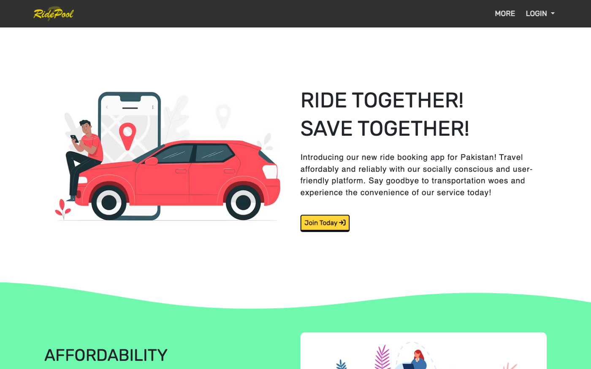
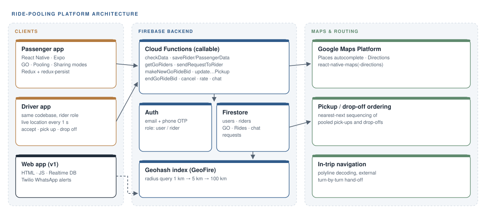
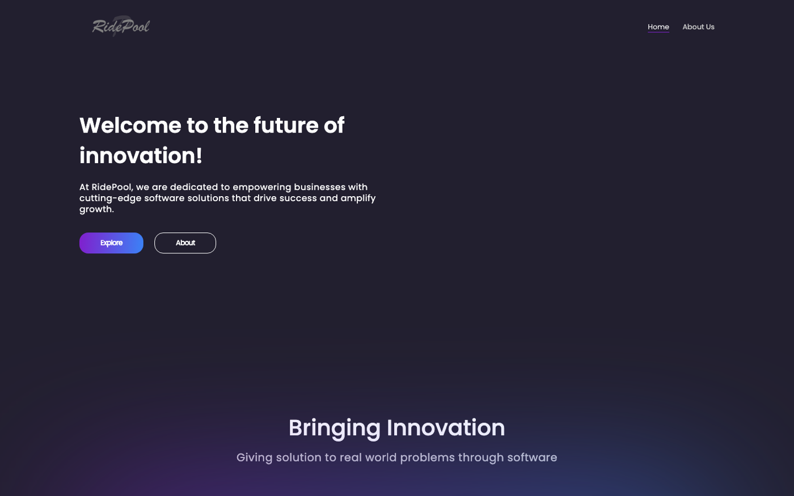

<div align="center">

# Ride-Pooling Platform

**RidePool, a ride-hailing and ride-pooling platform for Pakistan. Passengers can book a private ride, pool with others going the same way, or share a ride with friends, and a serverless Firebase backend matches them to nearby drivers in real time.**


</div>

<p align="center"></p>

## Overview

Urban transport in Pakistan is expensive for individual riders, yet most cars on the road carry one person. The platform tackles both sides of that problem:

| Mode | What the passenger gets |
|---|---|
| **GO** | A private ride. The app finds available drivers nearby, the passenger sends a request, and the accepted driver is tracked live to pick-up and drop-off. |
| **Pooling** | A shared ride with strangers heading the same way. Pick-ups and drop-offs are ordered so detours stay short and the fare is split. |
| **Sharing** | A ride booked for a group, such as friends or colleagues, travelling together. |

I was the **founding engineer**. I designed the application and backend architecture, built the first web version, and wrote the Firebase backend that the mobile app runs on. This repository consolidates the project's seven original repositories into one, with the **full commit history of every component preserved** (234 commits).

## Architecture

<p align="center"></p>

- **One app, two roles.** The Expo / React Native app serves both passengers and drivers. Role-specific screens live under `userUI/` and `riderUI/`. App state (screens, location, session) is held in Redux Toolkit and persisted with `redux-persist`, so an interrupted trip resumes where it left off.
- **Business logic stays on the server.** Every state change is a callable **Cloud Function**: registering, requesting a driver, creating a ride bid, picking up, cancelling, ending, rating, chatting. Each call checks Firebase Auth, the caller's identity and the availability of both parties before writing to Firestore. This keeps the clients thin and the rules in one place.
- **Finding nearby drivers.** Driver locations are stored with a **geohash** (GeoFire). `getGoRiders` runs a bounded geohash range query and filters by true distance. If nobody is found, the app widens the search radius from **1 km to 5 km to 100 km**.
- **Live trips.** During a trip the driver app publishes its location every second. The passenger sees the driver approach on a map, with routes from the Google Directions API and an in-ride chat. Drivers can hand off to an external navigation app for turn-by-turn guidance.
- **Pooling order.** For pooled trips, pending pick-ups (for passengers waiting to board) and drop-offs (for passengers on board) are kept in a priority list. The list is re-sorted by distance whenever someone books or boards, and the driver is routed through it nearest-first ([`web-app/algo.txt`](web-app/algo.txt)). The approach was informed by Lyft Line's published matchmaking work.

### Ride lifecycle (GO mode)

```
passenger                     Cloud Functions                         driver
    │  getGoRiders(lat,lng,r)  ──▶ geohash query, r = 1→5→100 km
    │  sendRequestToRider      ──▶ requests/{rider}                    ──▶ incoming request
    │                              makeNewGoRideBid  ◀──────────────────  accept
    │  ◀── live location, ETA, chat (sendMsgInChat) ──────────────────▶   navigate to pick-up
    │                              updateGoRideBidPickupStatus ◀───────  picked up
    │                              endGoRideBid ◀──────────────────────  dropped off
    │  addReviewAndRating      ──▶ ratings on both profiles
```

## Repository layout

| Folder | What it is | Stack | Origin |
|---|---|---|---|
| [`mobile-app/`](mobile-app) | Production passenger and driver app with GO, Pooling and Sharing flows | Expo 51, React Native 0.74, Redux Toolkit, react-native-maps, Firebase SDK | mobile app repo (133 commits) |
| [`backend/`](backend) | Serverless API: callable Cloud Functions for users, riders, rides, chat and ratings | Node.js, Firebase Functions v2, Firestore, GeoFire, Nodemailer | backend repo (32) |
| [`web-app/`](web-app) | First version: browser-based booking with live paths and WhatsApp notifications | HTML/CSS/JS, Firebase Auth and Realtime Database, Google Maps, Twilio | web app repo (36) |
| [`website/landing/`](website/landing) | Responsive marketing site for riders and drivers | HTML/CSS/JS | landing page repo (9) |
| [`website/company/`](website/company) | Company homepage | HTML/CSS/JS | company site repo (5) |
| [`prototypes/firebase-auth/`](prototypes/firebase-auth) | Sign-up, sign-in and sign-out prototype for React Native + Firebase | Expo, Firebase Auth | auth prototype repo (5) |
| [`prototypes/navigation/`](prototypes/navigation) | Map navigation prototype: animated car marker following a decoded route polyline | Expo, react-native-maps | navigation prototype repo (8) |

## Getting started

API keys and Firebase identifiers were removed from the code and its history. Wherever you see `YOUR_GOOGLE_API_KEY`, `YOUR_FIREBASE_API_KEY` or `YOUR_TWILIO_*`, substitute your own values.

### Backend

```bash
cd backend
npm install && (cd functions && npm install)
npx firebase login
npx firebase use --add          # select your Firebase project
npx firebase deploy --only functions
```

### Mobile app

```bash
cd mobile-app
npm install
# add your google-services.json and Google Maps key (app.json, components/, userUI/, riderUI/)
npx expo run:android           # or: npx expo start  (Expo dev client)
```

### Web app and websites

These are static sites. Serve the folder root, because the web app uses root-relative asset paths:

```bash
cd web-app && python3 -m http.server 8080      # http://localhost:8080
```

<details>
<summary><b>Company homepage</b></summary>
<p align="center"></p>
</details>

## Team

- **Danish Zulfiqar**: founding engineer. Application design, backend architecture, Cloud Functions, web app.
- **Abdul Haseeb Dar**: mobile app (React Native) and websites.
- **Dr. Riaz Hussain**: faculty advisor.

## History

The project grew across separate repositories, which were merged here with `git filter-repo`, keeping every component's history under its own folder:

web app (Feb 2023) → landing page and company site (2023) → mobile app (Oct 2023 – Nov 2024) → auth prototype and backend (2024) → navigation prototype (2024).

Run `git log -- <folder>` to see the history of a single component.
